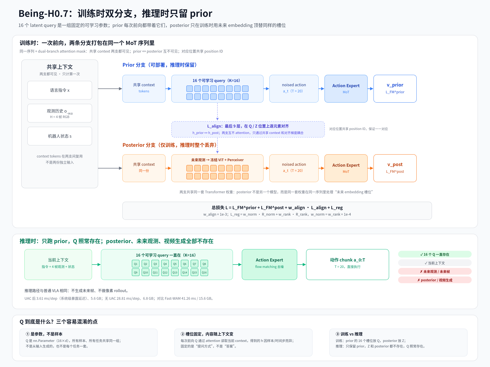

# Being-H0.7 论文解读：Latent World-Action Model

> **论文**：[Being-H0.7: A Latent World-Action Model from Egocentric Videos](https://research.beingbeyond.com/projects/being-h07/being-h07.pdf)  
> **项目页**：[research.beingbeyond.com/being-h07](https://research.beingbeyond.com/being-h07)  
> **代码**：[github.com/BeingBeyond/Being-H](https://github.com/BeingBeyond/Being-H)  
> **作者**：Hao Luo\*、Wanpeng Zhang\*、Yicheng Feng\*、Sipeng Zheng\*、Haiweng Xu、Chaoyi Xu、Ziheng Xi、Yuhui Fu、Zongqing Lu†（BeingBeyond / 智在无界）

**一句话总结**：Being-H0.7 是 BeingBeyond 的第三代 VLA，3B 参数。它的核心主张是“世界模型不必生成像素”：在感知与动作之间插入 16 个可学习的 latent query，训练时用一个“看得到未来观测”的 posterior 分支当老师，把未来信息蒸馏进“只看当前观测”的 prior 分支；推理时 posterior 整个丢掉，不生成任何未来帧。

---

## 1. 它想解决什么问题

### 1.1 VLA 的结构性瓶颈：观测稠密，动作监督稀疏

标准 VLA 把多模态观测和语言指令直接映射为动作。问题在于：观测是稠密、语义丰富的，而动作监督是稀疏的，并且与示范轨迹高度相关。这种不对称会鼓励模型学“捷径映射”——看到某个视觉线索就直接输出某个动作，而不是在中间建立对**物体动力学、接触、任务进度**的理解。结果是分布内表现很好，一旦需要预判“世界接下来会怎么变”，就容易失效。

### 1.2 世界动作模型（WAM）的两难

世界建模本来是对症的药：让机器人先想象场景如何演化，再决定动作。近年的 WAM 大多走“image-then-act”——先用视频生成模型 rollout 未来帧，再解码动作。未来帧确实提供了来自无标注视频的稠密监督，但论文认为这条路有三个根本代价：

1. **目标错配**：操作任务并不需要高保真重建未来视频，只需要接触、物体运动、affordance、任务进度这类紧凑线索。像素预测高度欠定——视觉上不同的未来可能对应同一个正确动作，视觉上合理的未来也可能对控制毫无帮助甚至误导。容量大量花在纹理、光照、背景上。
2. **训练成本**：继承视频生成的重训练成本，难以扩展到互联网级视频预训练。
3. **推理延迟**：test-time rollout 在每一步控制都增加额外延迟和显存，对动态任务（接球、传送带）是硬伤。Fast-WAM 虽然去掉了测试时展开，但仍然绑定视频生成训练，继承其成本、不稳定性和对不完美像素预测的敏感。

论文由此提出一个不同的问题：未来信息应该塑造策略的**内部推理**，但不必被重建成像素。机器人应该先问“哪些未来相关信息对控制重要”，而不是“下一帧长什么样”。

---

## 2. 核心思想：把世界模型搬到动作之前的隐空间

Being-H0.7 在感知与动作之间引入一个紧凑的 latent reasoning space。模型不再被迫从原始多模态上下文直接映射到低层动作，而是先形成“接下来这次交互中什么重要”的内部表征，再以它为条件生成动作。

| 范式 | 未来信息放在哪 | 推理时要生成未来吗 | 主要代价 |
|---|---|---|---|
| 直接 VLA | 不显式建模未来 | 否 | 容易学 shortcut，分布外预判弱 |
| 像素 WAM（image-then-act） | 未来 RGB 帧 | 是（或训练绑定视频生成） | 训练贵、推理慢、目标错配 |
| **Being-H0.7（latent WAM）** | **动作之前的 K 个 latent query** | **否** | 仍需未来帧做训练监督；latent 可解释性弱 |

论文给这个隐空间提了三个要求：足够紧凑以避免像素级冗余；足够表达以捕获动力学和 affordance；与动作生成紧密耦合，让未来建模服务于控制而不是视频保真度。

---

## 3. 方法拆解

### 3.1 第一步：插入 latent queries，给模型一个“思考槽”

在 Transformer 的输入序列里，把一小组可学习 query 插在“多模态上下文”和“动作 chunk”之间：

```text
S = [x; o_{-H:0}; s; Q; a_{0:T}]
```

其中 `x` 是指令，`o_{-H:0}` 是长度 H 的观测历史，`s` 是机器人状态，`Q ∈ R^{K×d}` 是 K 个 latent query，`a_{0:T}` 是长度为 T 的动作 chunk。这些 query 与指令、观测、状态、动作一起逐层传播：通过多层注意力，它们逐步聚合任务相关信息，组织成动作导向的隐状态，再反过来塑造动作生成。

但论文明确指出：**只靠动作监督，latent 不一定会长出“未来”**。它可能塌缩成一个弱的中间表示，或者只编码足以局部解码动作的浅层线索。所以还需要下一步。

### 3.1.1 输入序列的整体排列

论文 Eq. (1) 给的是单分支的排列：

```text
S = [x; o_{-H:0}; s; Q; a_{0:T}]

展开：
[语言指令 x] [观测历史 o（H=4 帧）] [状态 s] [Q1 … Q16] [带噪动作 a_t（T=20）]
```

**动作 token 在 16 个 Q 后面，位于序列末尾。** 不是插在 Q 中间，也不是在 Q 前面。

| 位置 | 内容 | 数量 | 处理方 |
|---|---|---|---|
| 1 | 语言指令 x | 变长语言 token | Understanding Expert（InternVL3.5） |
| 2 | 观测历史 o | H=4 帧；每帧视觉 token 数由 V-JEPA2.1 决定（论文未给具体数） | Understanding Expert |
| 3 | 机器人状态 s | 1 个或少量状态 token | Action Expert（Qwen3） |
| 4 | latent queries Q | 16 个 | 论文未明确；作为 latent reasoning 接口 |
| 5 | 带噪动作 a_t | T=20 个动作 token | Action Expert |

> **一句话**：Q 是动作前的 16 个“思考槽”，动作 token 紧跟在它们后面；动作头读的是 action token 位置的隐状态，不是 16 个 Q 的 last hidden state。

训练时 posterior 分支在同样的位置把 Q 换成 Z：

```text
Prior:     [x; o; s; Q1 … Q16; a_t^1 … a_t^20]
Posterior: [x; o; s; Z1 … Z16; a_t^1 … a_t^20]
```

两支打包进同一个序列时，共享 context 放在前面，分支专属 token 各自成组：

```text
[共享 context: x, o, s] [Q1…Q16] [a_prior] [Z1…Z16] [a_post]
```

共享 context 两支都可见；Q/prior 动作与 Z/post 动作之间被 attention mask 隔开。具体拼接顺序论文没有规定，图中是并排展示。

**注意三点：**

1. 这不是把一整串 token 喂给同一个 dense LLM，而是 MoT：语言/视觉走 Understanding Expert，状态/动作走 Action Expert。
2. Q 归哪个 expert，论文没有明确写；能确定的是它在序列里位于 action tokens 之前，并通过 attention 影响动作。
3. 动作 chunk 是 T=20；动作头在 action token 位置输出 flow-matching 速度场，积分后得到动作。Q 不参与动作读出位置，只作为条件。

### 3.2 第二步：训练期双分支，让未来观测当“老师”

论文构造了两个结构完全匹配的分支，共享同一套上下文、backbone 和动作生成通路：

- **Prior 分支（可部署）**：只用当前指令、观测历史、状态 + 可学习 latent queries 来生成动作。
- **Posterior 分支（仅训练）**：能访问未来观测。它把 latent queries 替换成同样形状的未来 embedding，其余结构不变。未来观测先过**冻结的预训练 ViT**，再由 **Perceiver resampler** 聚合成 K 个 future embeddings。

两条分支都接受动作监督，因此自然形成两种视角：prior 学“如何从当前上下文组织出推理状态再行动”；posterior 则揭示“未来里哪些信息对动作决策真正有用”。

[](being-h07-branches.png)

*图：Prior 在 16 个槽位放可学习 query Q；Posterior 在同样位置放未来 embedding Z。两支共享 context 和同一套权重，只在最后 9 层对齐 `h_prior` 与 `h_post`。推理时 posterior、Z、未来观测全部移除，Q 保留。*

### 3.3 第三步：隐状态对齐，把未来蒸馏进当前推理

在最后 L 层、latent 位置上，对两条分支的 hidden states 做逐元素对齐：

```text
L_align = (1/L) Σ_l (1/|h_l|) || h_l^prior − h_l^post ||_F²
```

关键设计是：两条分支**不允许直接互相 attention**，唯一的耦合就是这个对齐损失。于是 posterior 的“未来知识”只能通过共享上下文和对齐梯度，被蒸馏进 prior 的 latent queries。训练完成后，posterior 整个丢弃，推理时只保留 prior，零未来帧生成。

可以把它类比成非对称的 teacher-student / privileged information 学习：未来观测是训练期才有的特权信息，目标不是让学生复现未来像素，而是让学生在当前上下文里“像看过未来一样思考”。

### 3.4 第四步：防塌缩正则

只做对齐可能退化成平凡解：两条分支的隐状态一起缩小幅度或丢掉方向多样性。论文加了两个轻量正则：

- **范数保持**：`R_norm(h) = [ReLU(τ − ||h||_2)]²`，防止对齐后的状态幅度趋近于零。
- **谱多样性**：把同一分支、同一对齐层的多组 latent 状态投影到随机 n 维子空间，行归一化后算 Gram 矩阵，对其归一化特征值谱 `p_i` 计算负谱熵 `R_rank(H) = Σ_i p_i log p_i`。最小化它等价于让谱更平坦，鼓励隐空间各方向都被使用，防止方向坍塌。

总正则：`L_reg = w_norm · R_norm + w_rank · R_rank`。

### 3.5 工程实现：一次前向跑完两条分支

实现上沿用 Being-H0.5 的 Mixture-of-Transformers（MoT）：Understanding Expert（InternVL3.5）处理语言和视觉，Action Expert（Qwen3）处理状态和动作。两条分支被**打包进同一个序列**：

- 当前上下文 tokens 两支共享；
- 分支专属 tokens 占据不同的 latent 位置（prior 放 latent query，posterior 放 future embedding）；
- **dual-branch attention mask**：共享上下文对两支可见，但 prior 与 posterior 的 token 彼此不可见；
- 对应位置分配**相同的 positional ID**，保证两支在 Transformer 各层结构上严格对齐。

这样一次 backbone forward 就同时训练两支，避免了两次独立前向。动作生成用 flow matching，两支各算一份速度场损失：`L_FM = L_FM^prior + L_FM^post`。最终目标：

```text
L = L_FM^prior + L_FM^post + w_align · L_align + L_reg
```

### 3.6 训练配置速查

| 项目 | 设置 |
|---|---|
| 基础模型 | Being-H0.5；InternVL3.5（Understanding Expert）+ Qwen3（Action Expert） |
| 视觉编码器 | context 与 future 都用 V-JEPA2.1；context encoder 可训练，future encoder 冻结 |
| 输入分辨率 | context 224×224；future 256×256；仅 RGB |
| 关键超参 | 观测历史 H=4；动作 chunk T=20；latent query K=16；对齐最后 L=9 层 |
| 损失权重 | w_align = 1e-3；w_norm = w_rank = 1e-4 |
| 预训练数据 | UniHand 2.0 统一序列格式，混合人类与机器人操作轨迹；项目主页称 20 万小时第一人称人类视频 + 1.5 万小时机器人示范（论文正文只写 large-scale，未给精确数字） |
| 下游 post-training | 只优化动作目标 + latent alignment，不再用防塌缩正则；sequence packing，全局 batch 约 128 个 trajectory chunk |
| 模型规模 | 3B |

---

## 4. 训练目标：Q、两个分支和 loss

这一节把最容易混淆的几个点单独拎出来。

### 4.1 Q 是不是一直存在？

| 阶段 | Q | Z | posterior 分支 | 未来观测 |
|---|---|---|---|---|
| 预训练 | ✓ | ✓ | ✓（只训练） | ✓（只训练） |
| 后训练 | ✓ | ✓ | ✓（只训练） | ✓（只训练） |
| 推理 | ✓ | ✗ | ✗ | ✗ |

Q 是模型参数的一部分（16×d 的 `nn.Parameter`），在 prior 分支的预训练、后训练、推理中一直存在；posterior 分支在同样的 16 个槽位放的是 Z，不是 Q。推理时丢掉的是 Z、posterior 和未来编码器，Q 保留。

> **一个类比**：同一套权重 = 同一个学生做两遍同一道题。第一遍（prior）只看题目，用 16 张空白草稿纸 Q 推理解题；第二遍（posterior）题目一样，但允许看未来提示 Z。两遍答案都对着标准答案（真实动作）打分；老师额外要求第一遍草稿纸上的推理过程接近第二遍。考试（推理）时只做第一遍：Q 还在，Z、第二遍和未来观测都不在。

### 4.2 一次训练迭代发生什么

1. 采样一条示范：当前 context `c`（指令 + 4 帧 + 状态）、未来观测 `f`、真实动作 chunk `a`。
2. **Prior**：`c + Q` → 预测去噪速度 `v_prior`；和目标速度 `u_t = a − ε` 算 MSE，得到 `L_FM^prior`。
3. **Posterior**：`f → 冻结 ViT + Perceiver → Z`；`c + Z` → 预测 `v_post`；和同一条目标速度 `u_t` 算 MSE，得到 `L_FM^post`。
4. **对齐**：最后 9 层、16 个槽位，算 `L_align = mean((h_prior − h_post)²)`。
5. **总 loss 反传**：`L = L_FM^prior + L_FM^post + w_align · L_align + L_reg`。

### 4.3 四种 loss 分别是什么

| 项 | 谁和谁比 | 作用 |
|---|---|---|
| L_FM^prior | prior 预测的去噪速度 vs 目标速度 `u_t = a − ε` | 让部署分支会做动作 |
| L_FM^post | posterior 预测的去噪速度 vs 同一条目标速度 | 让 `h_post` 是“对动作有用”的未来信息 |
| L_align | `h_prior` vs `h_post`，最后 9 层 × 16 槽位 | 把未来感知蒸馏进 prior |
| L_reg | 隐状态自身范数 + 谱熵 | 防止对齐塌缩，权重 1e-4 |

注意：两个动作 loss 比的都是示范里的同一条真实动作 chunk，不是未来视频。未来视频只用来生成 Z，Z 只是 posterior 的输入。

```text
未来视频 f → 冻结 ViT + Perceiver → Z → posterior → h_post
                                                      │  L_align
当前 context c + Q → prior → h_prior ─────────────────┘
```

### 4.4 三个容易搞错的点

1. **不是把 Q 换成一个独立的 teacher 模型。** posterior 是同一套权重、同一个序列里的另一条分支；不是先训 teacher 再蒸馏，而是联合训练、联合对齐。
2. **不是拿 Q 和未来视频算 loss。** 整篇论文没有像素/视频重建 loss；未来视频只用来生成 Z，Z 只是 posterior 的输入；对齐目标是 `h_post`，不是 Z，也不是像素。
3. **不是只比最后一层 hidden state。** 是最后 9 层、16 个槽位，逐层逐槽位 MSE。

### 4.5 为什么 posterior 也要动作 loss

为了让 `h_post` 编码“对动作有用的未来信息”，而不是随便什么未来细节。动作 loss 把 posterior 的隐状态约束在能指导动作的方向上；prior 的动作 loss 保证部署分支本身会做动作；对齐 loss 再把 `h_post` 的未来感知搬进 `h_prior`。

### 4.6 一个值得注意的权重细节

两个动作 loss 的权重都是 1，对齐 loss 只有 1e-3，防塌缩正则 1e-4。动作预测是主任务，未来对齐是很轻的辅助正则。这也让“latent 对齐到底贡献多少”成为需要消融验证的问题。

---

## 5. 实验结果

### 5.1 仿真：六个 benchmark

**LIBERO / RoboCasa / GR1**

| 模型 | 规模 | LIBERO | LIBERO-plus | LIBERO-plus* | RoboCasa-50 | GR1 |
|---|---|---|---|---|---|---|
| π0.5 | 3B | 96.9 | 77.4 | - | 41.4 | - |
| Being-H0.5 | 2B | 98.9 | 78.5 | 83.1 | 53.5 | - |
| MINT-4B | 4B | 98.7 | 80.1 | 84.1 | - | - |
| ABot-M0 | 4B | 98.6 | 80.5 | - | - | 58.3 |
| Fast-WAM | 6B | 97.6 | - | - | - | - |
| LingBot-VA | 5B | 98.5 | - | - | - | - |
| Cosmos-Policy | 2B | 98.5 | - | - | 67.1 | - |
| **Being-H0.7** | **3B** | **99.2** | **82.1** | **84.8** | **62.1** | **49.2** |

**CALVIN / RoboTwin2**

| 模型 | 规模 | CALVIN | CALVIN* | RoboTwin2 (Easy/Hard) |
|---|---|---|---|---|
| π0.5 | 3B | 4.06 | 4.13 | 82.7 / 76.8 |
| Being-H0.5 | 2B | 4.63 | 4.48 | - |
| MINT-4B | 4B | 4.57 | - | - |
| ABot-M0 | 4B | - | - | 86.1 / 85.1 |
| Fast-WAM | 6B | - | - | 91.9 / 91.8 |
| LingBot-VA | 5B | - | - | 92.9 / 91.6 |
| **Being-H0.7** | **3B** | **4.67** | **4.48** | **90.2 / 89.6** |

**怎么读这张表**：论文的核心主张是“**最高平均排名**”和“**没有短板**”，而不是每个单项都第一。逐项看会更准确：

- **领先项**：LIBERO 99.2（第一）、LIBERO-plus 82.1（第一）、LIBERO-plus* 84.8（第一）、CALVIN 4.67（第一）；CALVIN* 4.48 与 Being-H0.5 并列第一。
- **非第一**：RoboCasa 62.1 低于 Cosmos-Policy 的 67.1；GR1 49.2 低于 ABot-M0 的 58.3；RoboTwin2 90.2/89.6 低于 LingBot-VA 的 92.9/91.6 和 Fast-WAM 的 91.9/91.8。
- **真正的卖点**：在一个模型上同时覆盖桌面操作、双臂人形、长程序列、环境扰动和跨环境零样本，且每个维度都接近或达到前沿——这种“全能型”比单榜 SOTA 更难。
- **鲁棒性**：RoboTwin2 从 Easy 到 Hard 只掉 0.6 个点（90.2→89.6），说明对域随机化不敏感。

### 5.2 真机：3 平台 × 12 任务 × 5 能力维度

| 平台 | 类型 | 身体 DoF | 手 | 总 DoF | 相机 | 策略频率 |
|---|---|---|---|---|---|---|
| PND Adam-U | 上半身人形 | 19 | Linkerbot O6（6 DoF）×2 | 31 | 2 个第一人称 | 20 Hz |
| Unitree G1 | 双臂人形 | 14 | Linkerbot O6（6 DoF）×2 | 26 | 1 个第一人称 | 10 Hz |
| Franka FR3 | 单臂桌面 | 7 | Linkerbot O6（6 DoF）×1 | 13 | 1 外置 + 1 腕部 | 20 Hz |

12 个任务覆盖 5 个能力套件：

| ID | 平台 | 主套件 | 任务 |
|---|---|---|---|
| 01 | Franka FR3 | Dynamic Scene | 在球滚出 capture area 之前接住快球 |
| 02 | PND Adam-U | Physical Reasoning | 用移液枪把液体从源容器转移到目标容器 |
| 03 | Unitree G1 | Motion Reasoning | 用球拍击球，使球落入标记区域 |
| 04 | PND Adam-U | Physical Reasoning | 把烧杯中的液体经漏斗倒入接收容器 |
| 05 | Unitree G1 | Dynamic Scene | 把杯中物体倒入移动的目标容器 |
| 06 | Franka FR3 | Dynamic Scene | 从移动传送带取货并放到正确货架层 |
| 07 | PND Adam-U | Physical Reasoning | 把衣物整齐折叠成目标形状 |
| 08 | Unitree G1 | Long Horizon | 在移动传送带上扫码并分拣包裹到正确目的地 |
| 09 | Unitree G1 | Long Horizon | 把鞋撑插入鞋内并把鞋放到传送带 |
| 10 | PND Adam-U | Long Horizon | 从传送带取鞋并装箱 |
| 11 | Franka FR3 | Generalization | 把桌面物体放到正确的抽屉层 |
| 12 | Franka FR3 | Physical Reasoning | 拿起锤子把钉子敲入孔中 |

| 能力套件 | Being-H0.7 | Being-H0.5 | π0.5 | Fast-WAM |
|---|---|---|---|---|
| Dynamic Scene | **70.0** | 47.5 | 49.2 | 58.3 |
| Physical Reasoning | **66.9** | 59.4 | 55.0 | 46.9 |
| Motion Reasoning | **67.5** | 46.7 | 45.8 | 57.5 |
| Long Horizon | **66.7** | 60.6 | 56.1 | 45.0 |
| Generalization | **67.5** | 57.5 | 58.3 | 49.2 |

**解读**：五个套件全部领先。最明显的优势在 **Dynamic Scene**（70.0 vs 最强基线 58.3）和 **Motion Reasoning**（67.5 vs 57.5）——这两类任务最吃“预判”，正好对应 latent future 的价值：接滚球、球拍击球、倒入移动容器、传送带交互，一旦状态估计过时，物体出了可交互窗口就立刻失败。Physical Reasoning 和 Long Horizon 上最接近的基线是 Being-H0.5，说明稳定的操作先验和分阶段一致性仍然是基础；Being-H0.7 在此之上还能领先，说明未来感知的先验没有牺牲因果一致性。

**评测协议**：所有策略走统一的 black-box 推理服务，场景布局和初始条件预定义，策略端点和 rollout 顺序随机化，操作员按固定二元标准判定成功，每任务 20 次盲测，且被测策略对操作员隐藏。这比“作者自己跑自己的模型”更可信，但仍是单团队自建场景与判定标准。

### 5.3 部署成本：latent WAM 的真正卖点

| 配置 | 平均推理延迟（ms/step） | GPU 显存（GB） |
|---|---|---|
| Being-H0.5 + UAC | 3.45 | 5.6 |
| Being-H0.7 + UAC | 3.61 | 5.6 |
| π0.5（TC-R） | 12.45 | 9.3 |
| Being-H0.5（无 UAC） | 17.12 | 6.8 |
| Being-H0.7（无 UAC） | 28.81 | 6.8 |
| Fast-WAM | 41.26 | 15.6 |

**UAC（Universal Async Chunking）是什么**：客户端维护线程安全的动作 buffer，并实时估计“下一 chunk 到位前还要消耗多少控制步”。控制线程按机器人频率从已提交的 prefix 里取动作；推理线程在 buffer 低于阈值时醒来，取最新观测、向服务器请求下一 chunk。核心规则是**已提交的 prefix 绝不改写**，只把未来 suffix 按估计延迟接回 buffer。这种 prefix-lock / suffix-update 设计吸收了模型、传输、调度的抖动，把 chunked prediction 变成连续控制。

**怎么理解 3–4 ms**：这是 UAC 后的“暴露步延迟”（系统级），不是单次模型前向时间。论文明确说延迟和显存是在同一套部署栈下测的，所以横向比较有意义；但不要把它当成“模型推理只要 3.6ms”。真正的前向成本看无 UAC 那一列：Being-H0.7 28.81ms，低于 Fast-WAM 的 41.26ms，但高于 π0.5 的 12.45ms。3B vs 6B 的规模差也要一起看。

---

## 6. 评价

### 6.1 值得肯定的地方

1. **问题选得准**：把“世界模型该在什么空间建模”从像素空间推到隐空间，论证链条完整——目标错配、像素欠定、训练/推理成本，三点都站得住。
2. **方法简洁可落地**：16 个 query + 一个训练期 teacher 分支 + 一个对齐损失，没有视频生成器；工程上用单序列 MoT + attention mask + 共享 position ID，干净且高效。
3. **监督信号巧妙**：未来观测是天然的 privileged information，视频里本来就有，不需要额外标注。相比“预测未来帧”，这更接近 JEPA / 世界模型的本意：学表征，不学像素。
4. **评测覆盖面广**：6 个仿真 benchmark + 3 个真机平台 + 12 个任务 + 5 个能力维度 + 延迟/显存，而且真机采用盲测。比单榜 SOTA 更能说明通用性。
5. **部署友好**：UAC 后 3–4ms 暴露延迟，与 VLA 同级，明显优于 test-time rollout 的 WAM；显存 5.6GB 也远低于 Fast-WAM 的 15.6GB。

### 6.2 需要保留的疑问

1. **不是每个 benchmark 都第一**：RoboCasa 62.1 < Cosmos-Policy 67.1；GR1 49.2 < ABot-M0 58.3；RoboTwin2 90.2/89.6 < LingBot-VA 92.9/91.6 和 Fast-WAM 91.9/91.8。论文的主张是“最高平均排名 + 无短板”，读的时候不要把 “best average rank” 误读成“全面 SOTA”。
2. **没有消融实验**：正文没有给出 K、L、w_align、两个正则项、posterior 分支有无的消融。因此“latent 对齐到底贡献了多少”缺少直接的因果证据，目前主要靠与 Being-H0.5 的整体对比和可视化支撑。这是全文最大的方法论空缺。
3. **真机规模仍有限**：12 个任务 × 每任务 20 trials，场景和成功判定由作者团队自建；跨实验室复现性未知。部分套件的提升只有几个点，论文没有报告置信区间或统计显著性。
4. **数据与算力不透明**：20 万小时人类视频 + 1.5 万小时机器人数据的筛选、质量、配比、训练成本都没有披露。代码已开源，但数据管线是否可复现存疑。
5. **future embedding 的质量依赖**：posterior 用冻结 V-JEPA2.1 + Perceiver resampler，K=16 是明显的信息瓶颈；如果未来帧本身模糊、多模态或与动作无关，对齐目标就会带噪声。论文没有分析失败模式或对齐目标的退化情况。
6. **latent 可视化是弱证据**：外部视频生成器能解码出合理未来，只能说明 latent 含有未来信息，不能证明这些信息就是动作所需的因果变量；生成图也可能被生成器的先验“补全”。
7. **延迟口径要小心**：3.61ms 是 UAC 后的系统级暴露延迟，不是模型前向时间；无 UAC 的 Being-H0.7 是 28.81ms，仍高于 π0.5 的 12.45ms。比较时要区分“模型快”和“系统调度掩盖了模型慢”。

### 6.3 适用边界

- **适合**：动态场景、接触密集、长程多阶段、需要预判但算力和延迟敏感的真机部署；有大量人类视频、机器人示范相对有限的数据条件；跨形态（单臂 / 双臂 / 人形）的统一策略。
- **需谨慎**：需要精确几何或物理量（间隙、力、位姿精度）的任务，latent 可能丢失细粒度空间信息；未来高度多模态的任务，单一 future embedding 可能模式平均；安全关键场景，latent 中间变量不可读、难审计。

---

## 7. 关键信息速查

| 项目 | 内容 |
|---|---|
| 论文 | Being-H0.7: A Latent World-Action Model from Egocentric Videos |
| 作者 | Hao Luo\*、Wanpeng Zhang\*、Yicheng Feng\*、Sipeng Zheng\*、Haiweng Xu、Chaoyi Xu、Ziheng Xi、Yuhui Fu、Zongqing Lu† |
| 机构 / venue | BeingBeyond（智在无界）；项目页标注 NeurIPS 2026；arXiv 2605.00078 |
| 模型规模 | 3B；InternVL3.5（Understanding Expert）+ Qwen3（Action Expert）；V-JEPA2.1 视觉编码器 |
| 预训练数据 | 约 20 万小时第一人称人类视频 + 1.5 万小时机器人示范（项目页口径）；UniHand 2.0 统一序列格式 |
| 核心超参 | H=4；T=20；K=16；对齐最后 L=9 层；w_align=1e-3；w_norm=w_rank=1e-4 |
| 推理特性 | 无未来帧生成、无像素 rollout、无视频生成器；posterior 分支训练后丢弃 |
| 仿真成绩 | LIBERO 99.2；LIBERO-plus 82.1 / 84.8；RoboCasa 62.1；GR1 49.2；CALVIN 4.67 / 4.48；RoboTwin2 90.2 / 89.6 |
| 真机成绩 | 3 平台、12 任务、5 个能力套件全部领先（Dynamic 70.0 / Physical 66.9 / Motion 67.5 / Long 66.7 / Generalization 67.5） |
| 部署成本 | UAC 后 3.61 ms/step、5.6 GB；无 UAC 28.81 ms/step、6.8 GB |

---

## 参考

- 论文 PDF：<https://research.beingbeyond.com/projects/being-h07/being-h07.pdf>
- 项目主页：<https://research.beingbeyond.com/being-h07>
- 代码：<https://github.com/BeingBeyond/Being-H>
