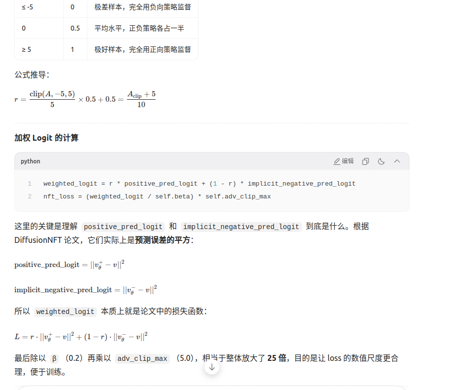
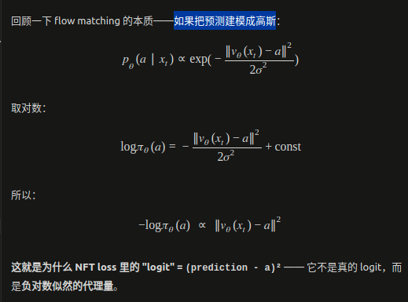

# RL 相关：NFT Loss

## nft loss

NFT Loss 的本质是：**用 advantage 作为软标签，对每个样本动态调整“正向学习”和“负向学习”的比例，好样本多学正向，坏样本多学负向，所有样本一起训练。**

其中的 `r` 就是把 advantage 压缩到 `[0, 1]`：

$$
r = \frac{\operatorname{clip}(A_t - 5, -5, 5)}{5} \times 0.5 + 0.5 = \frac{A_{\text{clip}} + 5}{10}
$$



### 加权 Logit 的计算

```python
weighted_logit = r * positive_pred_logit + (1 - r) * implicit_negative_pred_logit
nft_loss = (weighted_logit / self.beta) * self.adv_clip_max
```

这里的关键是理解 `positive_pred_logit` 和 `implicit_negative_pred_logit` 到底是什么。根据 DiffusionNFT 论文，它们实际上是预测误差的平方：

$$
\text{positive\_pred\_logit} = \|v_\theta^+ - v\|^2
$$

$$
\text{implicit\_negative\_pred\_logit} = \|v_\theta^- - v\|^2
$$

所以 `weighted_logit` 本质上就是论文中的损失函数：

$$
L = r \cdot \|v_\theta^+ - v\|^2 + (1-r) \cdot \|v_\theta^- - v\|^2
$$

最后除以 `beta`（0.2）再乘以 `adv_clip_max`（5.0），相当于整体放大了 25 倍，目的是让 loss 的数值尺度更合理，便于训练。

## 关于 logπ：高斯正比

关于 `logπ`，这里用的是高斯正比。



把预测建模成高斯：

$$
p_\theta(a \mid x) \propto \exp\left(-\frac{\|v_\theta(x_t) - a\|^2}{2\sigma^2}\right)
$$

取对数：

$$
\log \pi_\theta(a) = -\frac{\|v_\theta(x_t) - a\|^2}{2\sigma^2} + \text{const}
$$

所以：

$$
-\log \pi_\theta(a) \propto \|v_\theta(x_t) - a\|^2
$$

这就是为什么 NFT loss 里的 “logit” = (prediction - a)² —— 它不是真的 logit，而是负对数似然的代理量。
