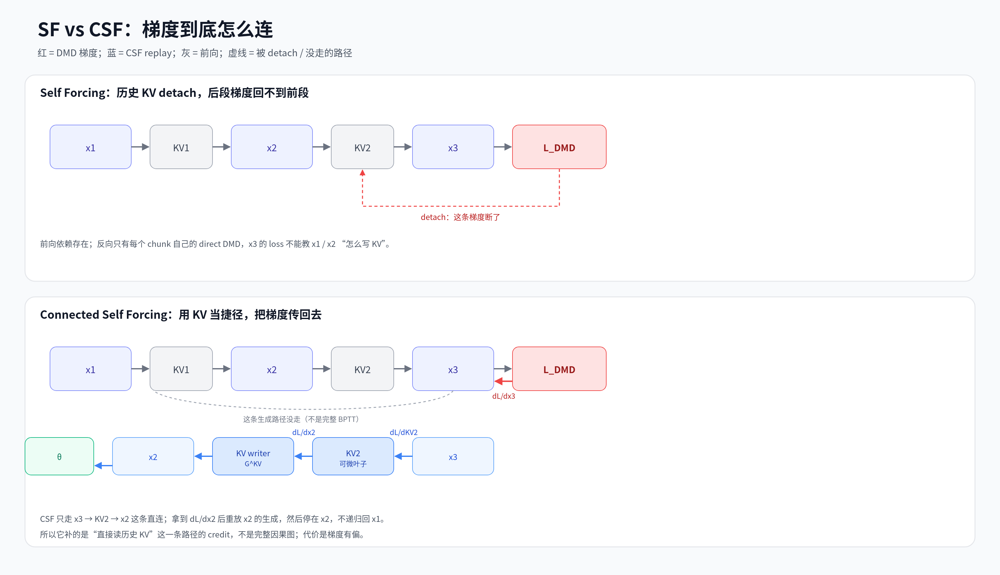

# Self Forcing / Connected Self Forcing 学习笔记

> **论文**：[Connected Self Forcing: Beyond Local Learning in Video Autoregression](https://arxiv.org/abs/2610.12156)  
> **项目页**：[eastbeanzhang.github.io/CSF](https://eastbeanzhang.github.io/CSF/)  
> **代码**：[github.com/EastbeanZhang/Connected-Self-Forcing](https://github.com/EastbeanZhang/Connected-Self-Forcing)（页面标注 coming soon）  
> **相关**：Self Forcing（Huang et al., 2025c）、DMD（Yin et al., 2024）

**一句话**：Self Forcing 用模型自己生成的 rollout 当训练历史，解决 teacher forcing 的 exposure bias；Connected Self Forcing 再把后段的 DMD 梯度通过历史 KV 传回前段，补上跨 chunk 的 credit，同时不改变推理。

---

## 0. 一句话版本

- **Teacher forcing**：训练用真实历史（GT）当上下文。
- **Diffusion forcing**：训练给不同帧/块不同噪声，让模型见过“带噪历史”。
- **Self forcing (SF)**：训练用模型自己生成的 rollout 当历史；历史 detach，省显存。
- **Connected SF (CSF)**：在 SF 基础上，把后段梯度经历史 KV 反传回前段；推理完全不变。

---

## 1. 问题：exposure bias

自回归视频生成是一段一段往后推的。训练时如果前面用真实视频当上下文，就是 teacher forcing：

- 训练：上下文永远干净、正确；
- 推理：上下文是模型自己生成的，可能有误差；
- 误差沿时间累积 → 越往后越糊、漂移，甚至“回冻”（运动量下降）。

**Diffusion forcing** 给不同帧/块不同噪声，让模型见过“带噪历史”，比纯 teacher forcing 鲁棒；但它用的仍是 GT 加噪，不是模型自己犯的错，和真实推理仍有 gap。

Self Forcing 进一步：直接用模型自己的 rollout 当历史，让训练分布贴近推理分布。

---

## 2. Self Forcing：用自己的 rollout 训练

### 2.1 做法

自回归 rollout：

```text
x_i = G_θ(z_i; sg(C_<i), c)
C_i = G^KV_θ(x_i; sg(C_<i), c)
```

- `z_i`：第 i 个 chunk 的带噪 latent；
- `C_<i`：前面 chunk 写下的 KV cache；
- `sg(·)`：stop-gradient，前向用历史，反向不传；
- `G^KV_θ`：KV writer，和生成器共享参数 θ。

每一步都按推理方式生成，然后用 **DMD** 给每个 chunk 一个直接梯度：

```text
g_i^DMD = ∂L_DMD / ∂x_i
```

### 2.2 为什么 detach

自回归 rollout 的每一步都包含多次去噪 + 写 KV。如果保留整条计算图做 BPTT，显存开销随 chunk 数线性增长，长 rollout 直接爆。所以 SF 把历史 latent / KV 做 `detach`：前向依赖保留，反向只更新当前 chunk。

### 2.3 局限：cross-chunk gradient gap

完整 BPTT 下，历史 chunk `x_j` 的梯度是：

```text
g_j^full = g_j^DMD + Σ_{i>j} (∂x_i/∂x_j)^T g_i^DMD
```

- 第一项：`x_j` 自己生成得好不好；
- 第二项：`x_j` 作为上下文，对后段 `x_i` 的贡献。

SF detach 历史后，第二项变成 0。`x_j` 只被“自己生成得像不像”监督，没有被“你写的 KV 对后段有没有帮助”监督。这就是 **cross-chunk gradient gap**。

---

## 3. Connected Self Forcing：把梯度接回来

### 3.1 核心思想

CSF 不改推理，只改训练时的梯度传播：

- 后段 chunk 的 DMD 梯度，经历史 KV 反传到“写这段 KV 的那次生成”；
- 再传到前段 chunk 的生成计算；
- 在目标 chunk 处停止，不做完整 BPTT。

[](self-forcing-gradient.png)

*图：SF 把历史 KV detach；CSF 用 KV 当直连旁路，把后段 DMD 梯度传回写 KV 的 chunk，停在目标 chunk。（点击看大图）*

### 3.2 Shortcut Gradient Replay

具体五步：

1. **Detached rollout**：正常生成 `x_1…x_N`，历史 detach；保存 replay 状态：采样到的 exit 输入 / timestep、生成的 latent、对应的 KV cache。
2. **算 DMD**：对整个 rollout 算一次 DMD，得到每个 chunk 的 `g_i^DMD`；后面 replay 复用，不重新采样。
3. **反向遍历 chunk（i = N…1）**：重放 chunk `i`，把它的历史 KV `C_j` 当作可微叶子，其余历史 detach，得到

   ```text
   g_Cj = (∂x_i/∂C_j)^T g_i^DMD
   ```

4. **穿过 KV writer**：把 `g_Cj` 通过 chunk `j` 的 KV writer 反传，得到

   ```text
   g_xj = (∂C_j/∂x_j)^T g_Cj
   ```

   然后用 `g_xj` 重放 chunk `j` 的生成，把跨 chunk 反馈加到生成参数上。

5. **累加并更新**：

   ```text
   g̃_j = g_j^DMD + λ_cross · Σ g_cross
   ```

   所有 chunk 的梯度累加后做一次 generator 更新；fake-score 按标准 DMD 目标更新。

### 3.3 为什么叫“shortcut”

因果 attention 让后段 chunk **直接读**历史 KV，所以 `x_i` 对 `C_j` 的依赖是一条直连路径：

```text
x_j → C_j → x_i
```

不需要沿着 `x_j → x_{j+1} → … → x_i` 一段段反传，直接跳到 `C_j`，省掉中间 chunk 的 Jacobian 和激活。

### 3.4 它连了什么、没连什么

CSF 只补了“直接读历史 KV”这一条路径：

- **连了**：`x_i → C_j → x_j`，即后段对历史 KV 的直接依赖；
- **没连**：`x_j → x_{j+1} → … → x_i` 这些经过中间 chunk 的路径；
- **没递归**：拿到 `dL/dx_j` 后停在 `x_j`，不再往 `x_{j-1}` 的生成分支传；
- **只覆盖 cache 窗口**：后段只直接读“3-frame sink + 最近 6 frame”的 KV，更早的 chunk 拿不到这条 cross 反馈；
- **可能冲突**：`g_j^DMD` 想让 `x_j` 自己好看，`g_cross` 想让它“对后段有用”，两者可能拉扯；λ_cross 是手调的。

所以 CSF 是一个**有偏但便宜的 credit assignment**：它补的是一条特定路径的梯度，不是完整因果图。

### 3.5 实际训练配置

- 生成器：Wan2.1-T2V-1.3B；
- real-score：冻结的 Wan2.1-T2V-14B；
- fake-score：可训练 Wan2.1-T2V-1.3B；
- 4 步去噪；21 个 latent frame 切成 7 个 chunk，每个 3 frame；
- 因果 cache：3-frame persistent sink + 最近 6 frame，最多 12 个 latent frame；
- 训练时随机选一个 exit step（4 步中的一步），整条 rollout 共用；
- AdamW，generator lr `2e-6`，fake-score lr `4e-7`；
- fake-score 每步更新，generator 每 5 步更新一次；1200 iterations ≈ 239 次 generator 更新；
- EMA 0.99；global batch 8；
- 推理：同样的 4 步因果采样和 KV cache，不做任何 replay；832×480，16 fps。

### 3.6 消融结果

在 60 秒 chunk-wise Causal CD 设置下：

- **Serial recursion**：质量和一致性接近 CSF，但 Dynamic Degree 明显更低；
- **Full BPTT**：在 Avg.(6) 和 Dynamic Degree 上没有超过 CSF；
- **CSF（λ=0.5）**：Dynamic Degree 上升，但质量和一致性下降。

说明 CSF 是“选择性梯度路径”的折中，不是“梯度接得越多越好”。

---

## 4. 方法对比

| 方法 | 训练历史 | 历史是否反传 | 主要 loss | 推理 |
|---|---|---|---|---|
| Teacher forcing | 真实 GT | 不需要 | flow / MSE / DMD | 自回归，容易糊/回冻 |
| Diffusion forcing | GT + 不同噪声 | 不需要 | flow / MSE | 自回归 |
| **Self forcing (SF)** | **模型自己生成** | **detach，不反传** | **DMD** | KV cache 自回归 |
| **Connected SF (CSF)** | **模型自己生成** | **选中路径反传** | **DMD + cross-chunk** | **和 SF 完全一样** |

---

## 5. DMD 是什么

### 5.1 三个角色

| 角色 | 是什么 | 作用 |
|---|---|---|
| **G（generator / student）** | 少步生成器，比如 1 步或 4 步去噪 | 要训练的学生 |
| **real-score** | 冻结的预训练扩散模型 | 知道“真实数据长什么样”，指向真实分布 |
| **fake-score** | 在线更新的扩散模型 | 跟踪“当前 G 生成的东西长什么样”，指向 G 的当前分布 |

DMD 的更新方向是：

```text
real score − fake score
```

即“真实分布的方向”减去“当前生成分布的方向”。G 沿这个方向更新，fake-score 继续跟上 G。

### 5.2 score 是什么

score 不是标量，是一个和输入同维的向量场：

```text
s(x_t, t) = ∇_{x_t} log p_t(x_t)
```

它指向“在噪声等级 t 下，往哪个方向走概率密度更高”。

### 5.3 为什么 score = −ε/σ_t

扩散的前向加噪写成：

```text
x_t = α_t x_0 + σ_t ε,    ε ~ N(0, I)
```

给定 `x_0` 时，`x_t` 服从均值 `α_t x_0`、标准差 `σ_t` 的高斯分布，所以条件 score 是：

```text
∇_{x_t} log p_t(x_t | x_0)
= −(x_t − α_t x_0) / σ_t²
= −ε / σ_t
```

对 `x_0` 取期望，得到边缘 score：

```text
s(x_t, t) = −E[ε | x_t] / σ_t
```

去噪网络 `ε_θ(x_t, t)` 学的就是 `E[ε | x_t]`，所以：

```text
s_θ(x_t, t) = −ε_θ(x_t, t) / σ_t
```

**注意**：不是除以时间 `t`，而是除以该时刻的噪声标准差 `σ_t`。很多教程把 `t` 直接当噪声等级，口语上会说成“噪声/时间”，精确写法是 `−ε/σ_t`。

直觉：模型预测“这张图里加了多少噪声”，把预测的噪声方向反过来，就是“往干净、概率高的方向走”的方向。

### 5.4 为什么 student 自己算的 score 不对

student 的 `v` 确实可以换算成 score，但关键是：这是**哪个分布**的 score。

- `s_student = −ε_student / σ_t`：student **想拟合**的分布的 score；
- `s_fake = −ε_fake / σ_t`：student **实际生成分布** `p_θ` 的 score；
- DMD 要的是后者。

一个 1D 例子：

- 真实数据 `p_real = N(0, 1)`；
- student 4 步采样实际产出 `p_θ = N(0, 2)`，偏糊；
- 但 student 的 `v` 仍在拟合 `N(0, 1)` 的 flow。

这时：

- `s_real ≈ score of N(0, 1)`；
- `s_student ≈ score of N(0, 1)`；
- `s_real − s_student ≈ 0`，DMD 会觉得“已经对齐了”，不会去修正 `N(0, 2)` 的方差。

但 fake-score 是在 student 实际产出的 `N(0, 2)` 样本上训练的：

- `s_fake ≈ score of N(0, 2)`；
- `s_real − s_fake ≠ 0`，它才会告诉 generator：“你的实际输出方差太大了，往 `N(0, 1)` 推。”

**结论**：公式一样，但 score 的对象不同。teacher 的 score 是 `p_real` 的；fake-score 的 score 是 `p_θ`（student 实际输出）的；student 自己的 score 是它训练时想拟合的分布的，不是它实际输出分布的。如果 student 本身就是一个“对自己的输出做去噪训练”的完整 diffusion model，那它自己的 score 可以用；但它现在是 few-step generator，不是这个角色。

### 5.5 fake-score 怎么来

fake-score 不是从数据里“长出来”的，也不是一个新数据集；它是一个可训练的 flow/diffusion 模型：

1. **初始化**：从同家族的预训练权重复制一份，常见是 generator 的初始权重，或同尺寸的 base 模型。论文里 fake-score 是 Wan2.1-1.3B，和 generator 同尺寸；real-score 是 14B。
2. **拿样本**：当前 generator 生成 `x̂_0`，**detach**。
3. **加噪**：`x_t = (1−t)x̂_0 + tε`（或对应的 `α_t, σ_t` schedule）。
4. **训练 fake**：fake-score 预测 `v_fake`，用 flow matching loss 拟合 `ε − x̂_0`（或噪声预测；符号取决于 path 约定），更新 fake-score。
5. **循环**：generator 更新后，fake-score 继续在它的新样本上训练，所以 fake 始终跟踪当前 `p_θ`。

所以：

- fake-score 是**在线训练**的，不需要单独离线训练一个模型；
- 它只学 generator 生成的分布，不学真实数据；
- 它不是 GAN 的 discriminator，不判断 real/fake 标签，而是给 score；
- 推理时 fake-score 和 real-score 都丢掉，只保留 generator。

### 5.6 和 MSE / flow、GAN、VSD 的区别

| 方法 | 目标 | 结果 |
|---|---|---|
| **MSE / flow** | 匹配一个具体 target | 未来不确定时，最优解是条件均值 → 糊 |
| **GAN** | 用 discriminator 做对抗 | 分布层面，但训练不稳定、min-max |
| **VSD** | 用预训练扩散当 score | 分布层面，但缺少对当前 G 的显式跟踪 |
| **DMD** | real-score − fake-score 做分布匹配 | 分布层面，更适合少步蒸馏，细节更好 |

一句话：**MSE 是“照着答案描”，DMD 是“请个懂真实数据的评委，把你的作品往真实分布推”。**

---

## 6. 评价与开放问题

### 6.1 值得肯定

1. **问题抓得准**：SF 的 forward–backward gap 是真实存在的；detach 省显存，但确实切断了跨 chunk 的 credit。
2. **不改推理**：CSF 只在训练时加 replay，推理还是原来的 4 步因果采样和 KV cache，部署成本不变。
3. **不加参数**：只是改梯度路径，模型结构不动。
4. **有系统性消融**：serial recursion、full BPTT、λ=0.5 都对比了，不是只报一个最好结果。

### 6.2 需要保留的疑问

1. **梯度有偏**：CSF 只补直接 KV 路径，忽略中间 chunk 的 Jacobian；它不是完整 BPTT，理论保证有限。
2. **fake-score 是移动目标**：G 每步变，fake 要追；收敛性没有强保证，更新频率很敏感。
3. **质量/运动量 trade-off**：一致性和 Dynamic Degree 此消彼长；视频变静态，一致性当然会变好，指标要一起看。
4. **实验范围有限**：单一 backbone、1200 iterations、一个训练 seed；换模型/领域是否成立，需要更多验证。
5. **缺少算力对齐的 baseline**：CSF 多出来的 replay 计算，如果拿去多训 G，能不能达到同样效果？论文没有完全回答。
6. **DMD 的稳定性**：原始 DMD 对超参敏感，DMD2 加了 GAN loss / two-time-scale 才更稳；CSF 用的是哪一版、稳定性如何，值得追问。

### 6.3 开放问题

1. rollout 深度/窗口怎么选？full rollout 和 partial rollout 的 trade-off 是什么？
2. DMD 和 flow/MSE 各自的适用场景？没有 real/fake score 时能做到什么程度？
3. Shortcut Gradient Replay 的显存/计算开销如何？长 rollout 怎么扩？
4. 初始化用 TF 还是 Causal CD？对 dynamics 和一致性有什么影响？
5. 长视频评测：quality/consistency 和 Dynamic Degree 如何平衡？
6. 迁移到其他 backbone/领域（如驾驶世界模型）时，哪些部分需要重做？

---

## 7. 术语表

- **chunk / block**：视频按时间切成的小段；自回归生成时一段一段往后推。
- **KV cache**：推理时缓存历史 attention 的 key/value，后段直接读，不重新算。
- **detach / stop-gradient**：前向还在用这段历史，但反向不传梯度。
- **rollout**：模型按推理方式自己生成一段视频。
- **teacher forcing**：用真实历史当上下文训练。
- **exposure bias**：训练看 GT、推理看自己生成的错误，分布不一致。
- **DMD**：Distribution Matching Distillation，用 real-score/fake-score 做分布匹配的蒸馏目标。
- **real-score / fake-score**：DMD 里判断“真实视频”和“当前生成分布”的两个模型。
- **Shortcut Gradient Replay**：CSF 的核心，把后段梯度经历史 KV 直接重放回前段，避免保留整条计算图。
- **TF init / Causal CD init**：两种初始化方式，影响训练早期的 dynamics 和一致性。

---

## 参考

- Connected Self Forcing 论文：<https://arxiv.org/abs/2610.12156>
- 项目页：<https://eastbeanzhang.github.io/CSF/>
- 代码：<https://github.com/EastbeanZhang/Connected-Self-Forcing>
- Self Forcing（Huang et al., 2025c）
- DMD（Yin et al., 2024）
